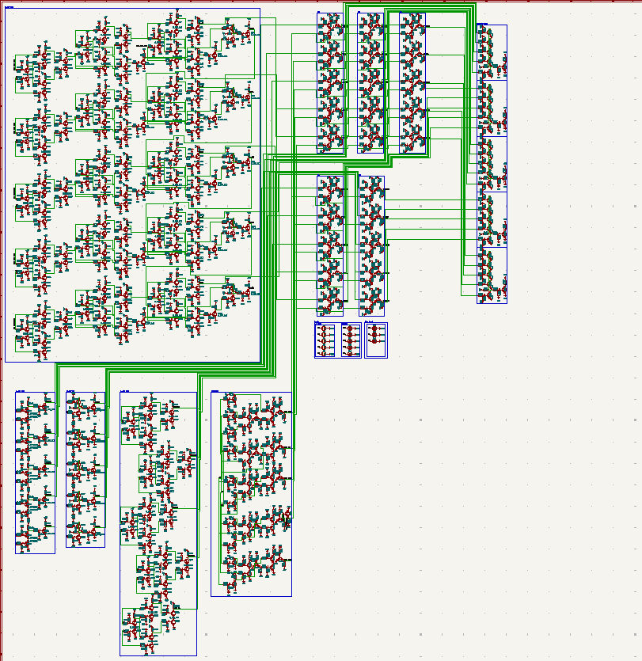
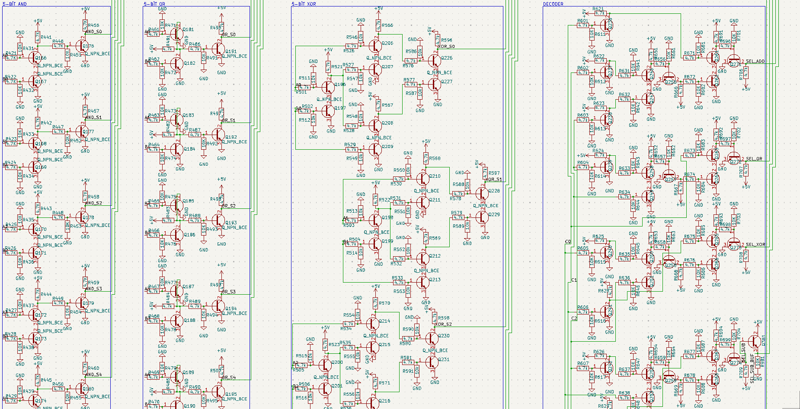
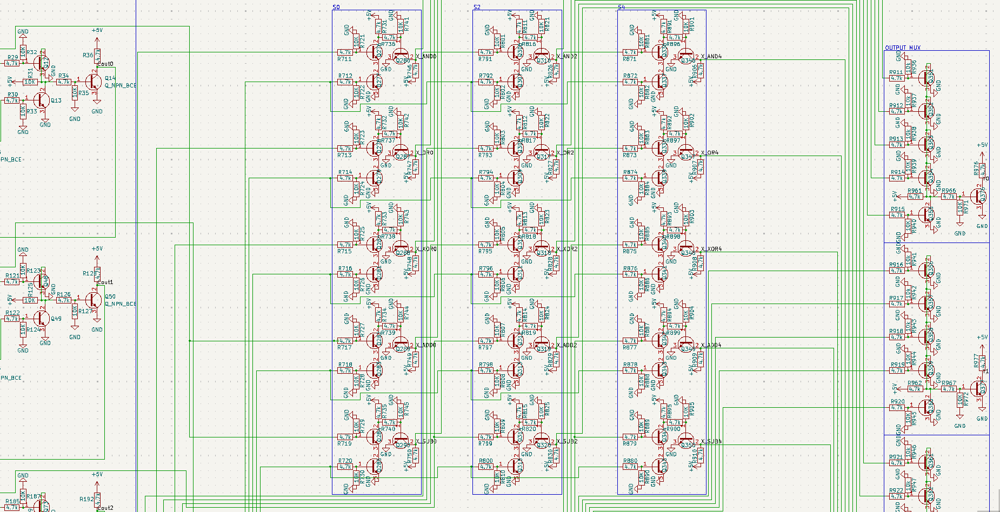
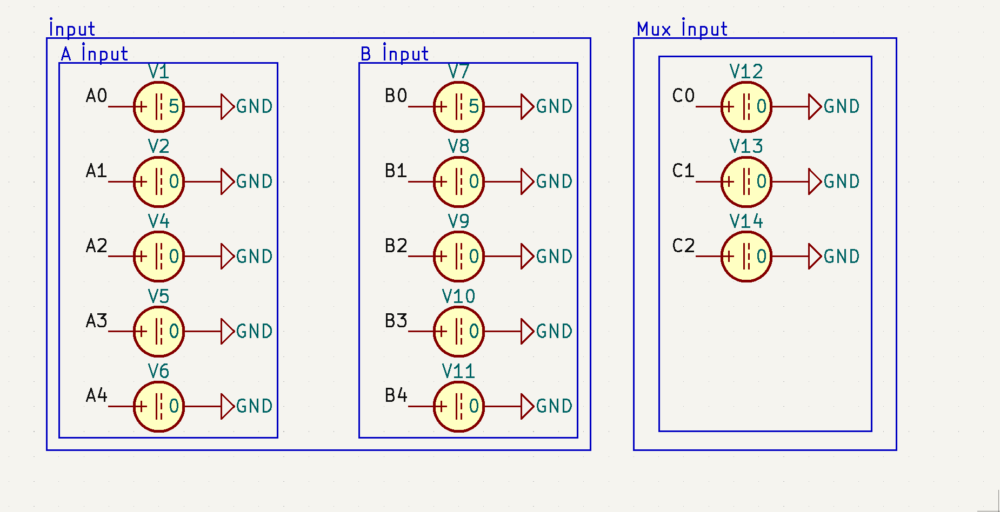
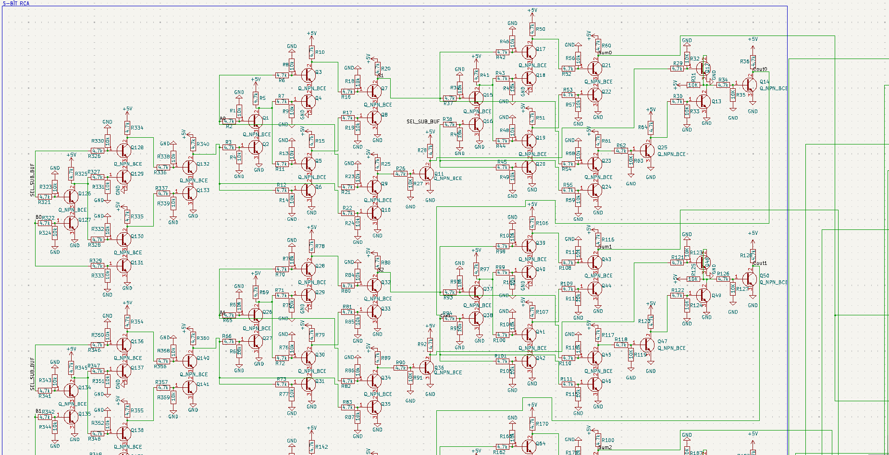

# 5-Bit Transistor-Level ALU

A 5-bit Arithmetic Logic Unit built from discrete NPN BJT-based logic, designed in KiCad and simulated with ngspice.

This project explores digital logic at transistor level and is one of my first steps toward designing my own processor.

## Features

| Item | Details |
|---|---|
| Data width | 5 bits |
| Transistor symbols | 381 × generic NPN (`Q_NPN_BCE`) |
| Resistors | 981 |
| Arithmetic unit | 5-bit Ripple Carry Adder (RCA) |
| Full-adder stages | 5 |
| Supply used in simulation | 5 V |
| Design tool | KiCad |
| Simulation engine | ngspice (KiCad Simulator) |

`Q_NPN_BCE` is a generic KiCad NPN BJT symbol. The schematic does not specify a particular physical transistor part number. The reported component counts refer to the schematic design.

## Supported operations

| Opcode | Operation | Example (A=`00101`, B=`00011`) | Expected output |
|:---:|---|---|:---:|
| `000` | ADD | 5 + 3 | `01000` |
| `001` | SUB | 5 - 3 | `00010` |
| `010` | AND | 5 AND 3 | `00001` |
| `011` | OR | 5 OR 3 | `00111` |
| `100` | XOR | 5 XOR 3 | `00110` |

## Architecture

- 5-bit Ripple Carry Adder consisting of five Full Adder stages
- AND logic unit
- OR logic unit
- XOR logic unit
- Operation decoder
- Output multiplexer
- Input and selection circuitry

## Simulation verification

All five operations were checked using the KiCad Simulator with ngspice. The tests used the same operands (`A = 00101`, `B = 00011`). Output nodes `Y0`–`Y4` were inspected as DC operating-point voltages.

| Operation | Opcode | Expected (`Y4…Y0`) | Observed (`Y4…Y0`) | Result |
|---|:---:|:---:|:---:|:---:|
| ADD | `000` | `01000` | `01000` | PASS |
| SUB | `001` | `00010` | `00010` | PASS |
| AND | `010` | `00001` | `00001` | PASS |
| OR | `011` | `00111` | `00111` | PASS |
| XOR | `100` | `00110` | `00110` | PASS |

For the recorded runs, output LOW levels were approximately 0.0415–0.0417 V and HIGH levels were 5 V. These are observed simulation values, not a formally specified logic-level standard. The selector nodes for the chosen operations measured approximately 1.448–1.468 V in the corresponding runs; inactive selectors were approximately 0.0415 V (except the SUB run, whose active selector was approximately 4.549 V). See the raw logs for complete node values.

**Scope:** These results demonstrate simulation behavior only. No physical prototype or PCB fabrication is claimed. The repository includes the KiCad schematic, not a verified fabricated board.

## Repository structure

```text
Images/                         Schematic screenshots
Hardware/Schematic/            KiCad schematic source
Simulation/Test_Cases/         Test vectors and expected outputs
Simulation/Results/             Verification summary and raw ngspice logs
Documentation/                  Design notes
```

## Project images

### Full schematic


### Logic units and decoder


### Logic and output MUX details


### Input sources


### 5-bit ripple carry adder


## Tools

- KiCad — schematic design and integrated simulation interface
- ngspice — circuit simulation engine

## Future work

Further exploration will include latches, flip-flops, registers, memory structures, and more advanced processor architecture concepts.

## License

No license has been selected yet. All rights reserved unless a license is added to this repository.
